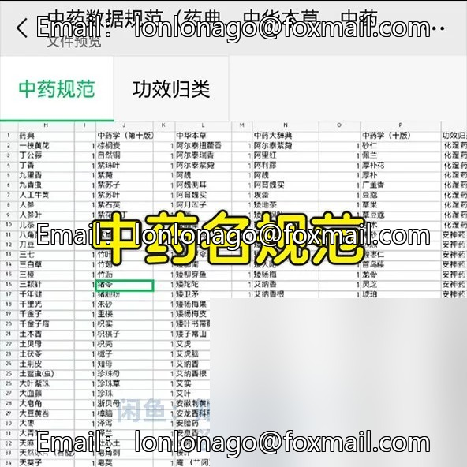
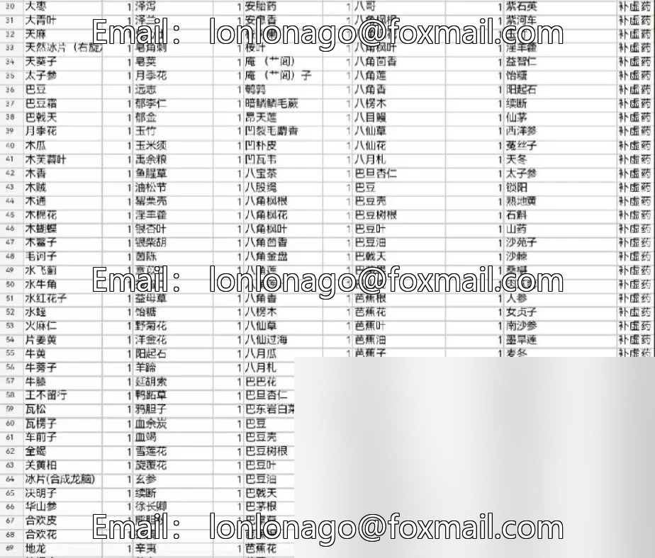

# Standardization of Chinese herbal names, has compiled and organized 2020 Edition of Chinese Pharmacopoeia, China Herb Books, and 10 editions of Chinese herbal names.

## Body

Regulations of TCM names Collected and organized the 2020 edition of the Chinese Pharmacopoeia. Chinese *Bencao*, Ten editions of Traditional Chinese Pharmacology Excel data organization. Traditional Chinese data standards Data mining research for traditional Chinese medicine.

web-based shipment, can be directly photographed and shipped.

The prescription names are organized according to the 2020 Chinese Pharmacopoeia, the Chinese Herbal Compendium and the tenth edition of Chinese herbal medicine, including file previews, efficacy categorization, herbal medicine studies and data mining research for TCM.

<!-- AI_ENRICHED -->

## Images

## Payment

Here is a pay link on Stripe ( https://buy.stripe.com/3cs8yP7sY87d0vu9AB ). Please contact me lonlonago@foxmail.com after funding $89, and I will send you a complete data files , thank you!

